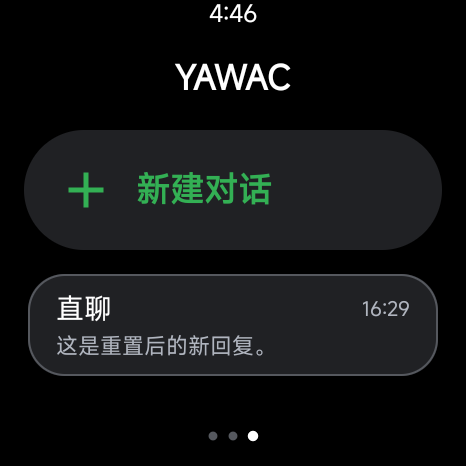
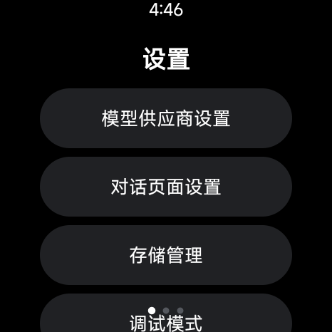

# YAWAC — Yet Another Wear AI Client

面向 Android 智能手表的 **BYOK（Bring Your Own Key）AI 对话客户端**。当前开发版 **1.34（versionCode 35）**，首发目标为 OPPO 手表应用商店。

自己的 API、自己的密钥、自己的对话。YAWAC 没有开发者代理后端，聊天和配置保存在手表本地。

<p align="center">
  
  
  
</p>

## 是什么

YAWAC 把手表变成一台可以直接对话的 AI 终端：

- 用户自行填写兼容 OpenAI Chat Completions 的 API URL、Key 和模型；内置 DeepSeek 预设。
- 为圆屏、小屏和触控交互优化：黑色背景、圆屏安全区、透明悬浮时钟、大点击区域、跟手右滑返回。
- 支持多会话记录、草稿、停止、原位重试、Markdown/表格/LaTeX、独立阅读页和阅读字号。
- API Key 使用 Android Keystore 加密保存，不上传开发者服务器。

## 主要功能

### 三页主页

左右滑动切换三页，底部圆点跟随拖动：

- **左页：设置** —— 模型供应商、对话外观、存储管理、调试模式。
- **中页：直聊（默认启动页）** —— 打开 App 即进入对话。
- **右页：对话记录** —— 多会话历史、新建、删除。

### 直聊与上下文重置

- 直聊是一个固定的持久会话，历史记录跨启动保留，并显示在对话记录列表中。
- 每次 App **冷启动**会在消息流中插入一条小字提示“AI 上下文已重置，以上消息仅作记录”。
- AI 只会收到最新提示之后的消息；更早的历史仍可在手表上回看。
- 退回后台再回来不会重置；没有新消息时连续冷启动不会重复插入提示。
- 普通对话不受影响，按原有方式保留完整上下文。

### 思考与联网辅助

DeepSeek 官方地址支持：

- **思考强度**：关闭 / 低 / 高 / 最高，滑条连续跟手、松手吸附，每条消息记录自己的档位。
- **联网辅助**：先由模型规划是否需要外部资料，需要时调用 DeepSeek Search；回答以用户条件和独立分析为主，网页只用于核实与补充。

自定义兼容服务只使用普通 Chat Completions 请求，不发送 DeepSeek 专有参数。

### 手机配置 API Key

设置 → 模型供应商设置 → **用手机配置 API Key**：

- 手表启动一个临时局域网配置服务，显示二维码和地址。
- 手机与手表在**同一 Wi-Fi** 时，手机相机扫码即可打开配置页。
- 没有共同 Wi-Fi 时，可打开**手机个人热点**，在手表 Wi-Fi 设置中连接该热点，再回到配置页扫码。
- 手机网页填写 API URL、Key、模型，保存后手表加密落盘，配置页立即失效。
- 页面使用一次性 token，只绑定手表当前局域网地址；Key 通过 POST 正文发送，不出现在 URL 或页面源码中。

没有可用网络时，仍可在手表上手动填写。

### 阅读、渲染与本地记录

- Markdown、管道表格、LaTeX 公式，长回复进入独立阅读页，阅读字号与聊天字号独立。
- 长回复最后一行可以滚到悬浮输入框上方；回到最新按钮使用矢量图标。
- 可选本地调试记录（默认关闭）：上下文、搜索决策、参考资料、服务商公开返回的思考内容和阶段耗时，支持查看与导出；有容量上限和截断标记。

### 手表原生控件

通过已安装的 Heytap 应用运行时桥接 `HeyArcTextClock`、`HeyImageButton`、`HeyShapeButton`、`HeySwitch` 等控件；来源应用缺失或版本变化时自动回退到项目自有控件。仓库不包含厂商 APK、系统字体或反编译资源。

内嵌用户提供的 **MiSans Regular**，原文件和许可随包保留；ttf 不压缩打包以减少冷启动解压开销。

## 快速开始

1. 安装 APK 并打开 YAWAC，阅读并同意用户协议与数据说明。
2. 按动画引导完成一次右滑、点按、左滑和新建练习对话（可跳过，可中断恢复）。
3. 打开 **设置 → 模型供应商设置**：
   - **用手机配置**：按页面提示扫码填写；或
   - **手动填写**：API URL、API Key、模型 ID。
4. 回到直聊或新建对话开始提问。

### 支持的 API

- HTTPS 的 OpenAI Chat Completions 兼容服务：Bearer 认证、`model`、`messages`、`stream=false`，读取 `choices[0].message.content`。
- 内置 DeepSeek 预设：`https://api.deepseek.com`，模型列表 `deepseek-flash`、`deepseek-v4-pro`（实际可用性以 DeepSeek 服务端和账户权限为准，可手填其他模型）。
- 暂不支持 Responses、Anthropic 专用协议、多模态、通用工具执行、流式输出、动态模型发现或无密钥服务。
- HTTP 自动重定向已关闭，避免把当前 Key 转发到其他端点。

## 数据与隐私

| 数据 | 位置 / 处理 |
| --- | --- |
| 聊天与草稿 | 应用私有目录 `chats.json`，AtomicFile 写入并保留备份 |
| API 配置 | `no_backup/api-config.enc`，Android Keystore + AES-GCM，不随系统备份迁移 |
| 调试记录 | 默认关闭；`no_backup/debug-traces`，凭据脱敏，有容量上限 |
| 界面偏好 | `shared_prefs/wearai_prefs.xml`（沿用旧内部名称，兼容已有数据） |

- 提问、有效聊天历史、自动标题文本会发送到用户配置的 API 服务。
- 开启联网辅助会额外发送规划请求和搜索 query；自动标题也会发起请求并消耗额度。
- 清除 API 配置不会删除聊天；清空聊天不会删除 API 配置或调试记录。
- 聊天目前是私有目录明文 JSON；`allowBackup=true` 仍保留，完整聊天加密/导入导出/损坏恢复尚未实现。

## 构建

需要 JDK 17、Android SDK 34：

```bash
export JAVA_HOME=/path/to/jdk17
./gradlew :app:assembleDebug :app:testDebugUnitTest :app:assembleDebugAndroidTest
```

- Android Gradle Plugin 8.7.3，Gradle 8.11.1，minSdk 30 / compileSdk 34 / targetSdk 34。
- JVM 测试使用 JUnit 4 / MockWebServer；Android 交互测试使用平台 `android.test.InstrumentationTestRunner`，需连接模拟器或设备。
- Release 需要本机签名材料，仓库不包含 keystore、密码或内置 Key。个人构建可用 `tools/build-release.ps1`，从仓库外的本地文件读取签名密码和可选的默认 Key；分发构建应保持默认 Key 为空，让用户自行配置。

截至 2026-11-14：**88 项 JVM 测试、75 项 Android 仪器测试通过**（Android 测试在 466×466 / density 320 的模拟器上执行，不等同于 OPPO 真机验收）。

## 项目结构

```text
app/src/main/java/com/yawac/client/
├── App.java                 应用入口，后台预载与调试工厂
├── data/                    聊天模型、仓库、存储、API 配置、调试记录、直聊
├── net/                     Chat Completions、参考规划、Search、本地配置服务
└── ui/                      三页主页、聊天、阅读、设置、二维码配置、滑动返回
```

- `data/DirectChat.java`：固定直聊会话与冷启动上下文边界。
- `ui/ChatPageView.java`：主页直聊与普通聊天复用的聊天界面。
- `ui/PhoneSetupActivity.java` + `net/ProvisioningServer.java`：手机扫码配置与本地 HTTP 服务。
- `tools/build-release.ps1`：本地签名 Release 构建脚本。
- `tools/export_debug_traces.py`：通过 ADB 导出本地调试记录。

## 已知限制

- 开发预览版本，尚未上架 OPPO 应用商店；其他品牌、Wear OS 专门适配和 Google Play 流程暂不在首发范围。
- OPWW234 的 Android 11 构建**没有暴露 Wi-Fi Direct**（无 `FEATURE_WIFI_DIRECT` / `wifi_p2p` 服务），手机配置使用同一 Wi-Fi 或手机热点，不依赖 P2P。
- 手机热点方案首次需要把手表连接到热点，热点密码仍需在手表上输入一次。
- Heytap 控件依赖已安装的来源应用，来源更新或缺失时回退；正式分发授权和兼容矩阵仍待确认。
- 1.31 的历史性能样本显示冷启动约 1.53s → 1.20s，长帧仍未完全消除；1.34 的真机滚动、耗电和不同 OPPO 机型仍需专项验收。
- 聊天明文存储、系统备份和正式签名切换前的数据迁移尚未完成。

## 文档

- [当前接力文档 HANDOFF.md](HANDOFF.md)：源码导航、约束、设备与数据边界、后续路线。
- [1.34 记录](docs/yawac-1.34.md)：直聊主页、上下文重置、手机配置与 1.34 验证范围。
- [1.33 右滑返回](docs/yawac-1.33-swipe-back.md)：透明二级页面与跟手返回。
- [1.32 调试模式](docs/yawac-1.32-debug-mode.md)。
- [1.31 性能记录](docs/yawac-1.31-performance.md)。
- [Heytap 独立适配指南](docs/heytap-ui-porting-guide.md)。
- [OPPO 上架路线](docs/release-roadmap.md)。

## 许可与第三方组件

- MiSans Regular 的许可与声明见 `app/src/main/assets/licenses/`。
- 使用 AppCompat、Material Components、RecyclerView、OkHttp、Markwon、ZXing 等开源组件，遵循各自许可证。
- 本仓库当前为私有开发仓库，代码本身尚未声明开源许可证。
